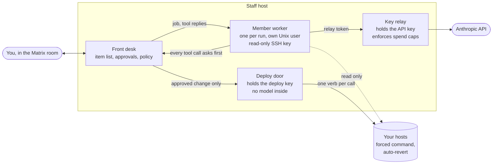

# Home staff

A small staff of AI agents that lives on a NixOS homelab, owns parts of it,
and gets things done. You talk to them in one Matrix room. They fix problems
you didn't know about, carry requests through to done, and stay quiet when
there is nothing worth saying.

> **Status: pre-release.** Everything here is built and unit-tested, and the
> Nix package and modules evaluate. Nothing has run on a live host yet. The
> list of [what is unproven](#what-is-unproven) is kept honest and current.

## What it looks like

```text
alerts   zpool tank on silverstone: 1 device with read errors
fleet    Taking this. Reading the pool and the disk.
fleet    Proposal for item 12: /dev/sdc has 14 reallocated sectors and the
         weekly scrub has been failing since the 9th because its timer
         points at a pool name that no longer exists. Fix is one line in
         hosts/silverstone/zfs.nix:

           hosts/silverstone/zfs.nix   +1 -1

         Touches silverstone only. I'll check the scrub starts and the timer
         is listed. Rollback is automatic if the host is unhealthy after the
         switch. The disk itself needs replacing; that part is yours.
         👍 to deploy, 👎 to drop.
tom      👍
fleet    Deployed to silverstone and confirmed healthy. Scrub started at
         20:41, timer next fires Sunday. Closing item 12.
```

That exchange is the whole product: a problem said once, investigated before
anyone is asked, a proposal that fits in one message, a thumbs-up, and a
result that was checked.

## How it behaves

The rules are in [BRIEF.md](BRIEF.md). The short version:

- **Driven by open work, never by the clock.** No daily report. No message
  exists because a timer fired.
- **Done means the world changed and it was checked.** A message is never
  the finish line.
- **A problem is said once.** It becomes one tracked item, worked until
  fixed or dropped. Embeddings match a new alert against open items so the
  same problem never opens twice.
- **Gumption before asking.** Read, inspect, and try first. Ask with a best
  guess to confirm.
- **Pitch, then build.** Investigation is free. Anything beyond a small fix
  is pitched first and built only after a yes.
- **One unprompted item a day, at most.** A ceiling, never a quota. Most
  days the right number is zero.

## The safety model

> Members can read everything and change nothing. Every change to the world
> goes through one door, and the door's caller checks the owner's yes itself.

An agent with a shell and a deploy key is one bad paragraph away from
breaking a house. So no agent here holds a credential that can change
anything. The two things worth stealing, the API key and the deploy key,
each sit in a small process with no model inside.



What each piece guarantees:

| Piece | What it holds | What it cannot do |
|---|---|---|
| **Member worker** | A work folder, a read-only SSH login, a relay token | Change a host, see the API key, see another member's files, spend past the cap |
| **Front desk** | The item list, the room, the record of what you approved | Deploy by itself: it has no deploy key |
| **Key relay** | The Anthropic key | Anything but forward two API endpoints and count the cost |
| **Deploy door** | The only deploy key | Think. It is a few hundred lines of plain code with fixed rules |

The rules the door enforces, whatever anyone asks it:

- **A yes covers one exact change.** A proposal fixes the commit and the
  hosts, and the front desk writes the diff into the room itself, from the
  door's reply, so what you approve is what gets deployed. Your yes counts
  only on that message, for 24 hours, once per host. A new proposal, a no,
  or a "not like that" clears it.
- **Nothing reaches a host before the yes.** Not even a dry run: a dry
  activation runs the new system's scripts as root, so it is gated like a
  deploy.
- **Every switch reverts by itself.** The host builds the new system,
  arms a timer, and activates without changing the boot default. Only a
  health check that passes makes the change permanent. A host that hangs,
  loses its network, or reboots comes back on the old system.
- **Canary first.** Hosts roll in a fixed order. A later host is refused
  until every earlier one has switched and been confirmed healthy.
- **Nothing changes while you sleep.** Between midnight and 7 a.m. the door
  refuses every change unless the item is urgent. The host that runs the
  house is refused even then, unless you approved it during that same night.
- **Spend has a hard stop.** The relay counts every response at list price
  and answers 429 at the daily or monthly cap. An agent in a loop runs out
  of money, not out of your money.

The full wire formats and paths are in [ARCHITECTURE.md](ARCHITECTURE.md).

## Install

The staff is a flake. Your hosts take it as an input, so it is developed
here and arrives on your machines with `nix flake update`.

```nix
# flake.nix of your fleet
inputs.home-staff.url = "github:OWNER/home-agent";
inputs.home-staff.inputs.nixpkgs.follows = "nixpkgs";
```

On the one host where the staff lives:

```nix
imports = [ inputs.home-staff.nixosModules.default ];

services.home-staff = {
  enable = true;
  homeserver = "https://matrix.example.org";
  roomId = "!abcdefghijkl:example.org";
  tom = "@owner:example.org";
  alertsUser = "@alerts:example.org";
  ollamaUrl = "http://ollama.example.org:11434";
  anthropicKeyFile = config.sops.secrets."home-staff/anthropic-env".path;
  members = {
    chief = { userId = "@chief:example.org"; model = "claude-haiku-5-5";
              tokenFile = config.sops.secrets."home-staff/chief-token".path; };
    fleet = { userId = "@fleet:example.org"; model = "claude-sonnet-5-5";
              tokenFile = config.sops.secrets."home-staff/fleet-token".path;
              sshKeyFile = config.sops.secrets."home-staff/fleet-read-key".path; };
  };
  door = {
    repoUrl = "git@github.com:OWNER/your-fleet-flake.git";
    deployKeyFile = config.sops.secrets."home-staff/deploy-key".path;
    hosts = {
      suzuka = { address = "suzuka.example.org"; hostKey = "ssh-ed25519 AAAA..."; };
      monza  = { address = "monza.example.org";  hostKey = "ssh-ed25519 AAAA..."; };
    };
    repoHostKeys = [ "github.com ssh-ed25519 AAAA..." ];
  };
};
```

On every host the staff may read or deploy to:

```nix
imports = [ inputs.home-staff.nixosModules.host ];

services.home-staff-host = {
  enable = true;
  readKey = "ssh-ed25519 AAAA... staff-read";
  deployKey = "ssh-ed25519 AAAA... staff-door";
};
```

That adds two users and one sudo rule per host: `staff-read` (no sudo) and
`staff-deploy` (a forced command, and passwordless sudo for exactly one
root-owned script in the Nix store). Every option is documented in
[nix/README.md](nix/README.md).

You also need a Matrix homeserver with one account per member, and an
Ollama instance serving `bge-m3` for embeddings.

## Cost

Built to stay under **$100 a month** of API spend, with defaults of $3.00 a
day, $95.00 a month, and $0.75 per run. A small, cheap model routes
messages; members run on a mid-tier model; nothing runs when there is no
open work. The caps are enforced in the relay, outside any agent's
judgment. Set a spend limit in the Anthropic console as well: two locks are
better than one.

## Teardown

If it disappoints you, removing it is a small diff: delete the flake input
and the two imports, then rebuild. Units, users, sudo rules, and config
files go with them.

What NixOS does not remove for you:

```bash
sudo rm -rf /var/lib/home-staff                # staff host: item list, lessons, checkouts
```

```bash
sudo rm -rf /var/lib/staff-deploy              # every host: unpacked flake sources
```

```bash
sudo rm -f /var/log/fleet-deploy/staff-*       # every host: deploy logs
```

Outside the hosts: the members' Matrix accounts and the room, any
`staff/*` branches in your fleet repo, the deploy key registered on that
repo, and the secrets you added for it.

## What stays private

This repo is code only. The item list, the lessons the staff learns about
you, and the inventory of your network live on the staff host and are never
pushed anywhere. No member has write access to this repo: the staff can
change its behavior through its lessons, never its own code or permissions.

## What is unproven

Tested here means unit tests with fakes and a Nix evaluation. These have
not yet been seen working on a real host:

- The Claude Code CLI talking to the API through the relay, including how
  it reacts to a 429 at the cap.
- Socket-started member workers under systemd with the full hardening set.
- The host scripts on a real machine: the transient revert timer,
  `switch-to-configuration test` followed by a confirmed boot default, and
  the sudo rule under `sudo-rs`.
- The staff host deploying to itself and picking the work back up after
  its own services restart.
- A full week against the first milestone in [BRIEF.md](BRIEF.md).

Known limits: the door's host names and roll order (`suzuka`, `spa`,
`silverstone`, `monza`) are fixed in `staff/door.py` to the author's fleet,
with `monza` as the host that runs the house. To use this elsewhere, change
that list first.

Not built yet: the Home Assistant owner and its sleep gate (the second
milestone), the urgent phone-push path, and the weekly retro trigger.

## Layout

```text
BRIEF.md          what the staff must do; the source of truth
ARCHITECTURE.md   who holds what, wire formats, the door's rules
staff/            front desk, worker, relay, door, item list, policy
members/          one file per member: instructions, tools, model
nix/              the two NixOS modules and the host-side deploy scripts
tests/            unit tests
```

## Development

```bash
nix develop -c pytest -q
```

```bash
nix build .#default
```

## License

MIT. See [LICENSE](LICENSE).
